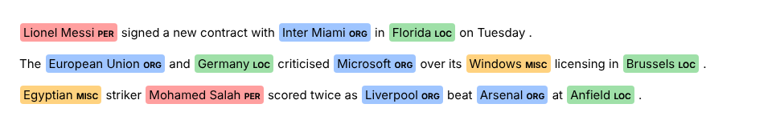
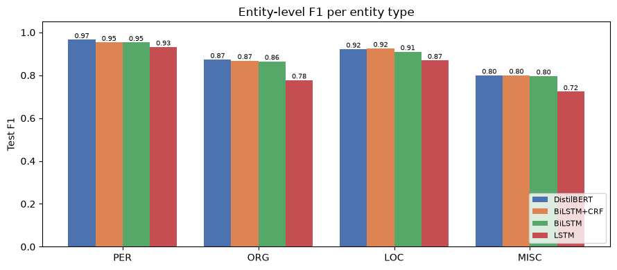
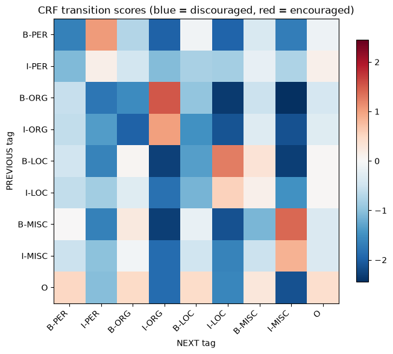

# Named Entity Recognition on CoNLL-2003

A sequence labeling project that finds people (PER), organizations (ORG), locations (LOC) and other names (MISC) in English text.

I compared four models on the same data: LSTM, BiLSTM and BiLSTM + CRF (built from scratch in PyTorch) and a fine-tuned DistilBERT (HuggingFace). The best model is served in a Gradio app that highlights entities while you type.



## Results

Test set, entity level, seqeval with strict IOB2 (an entity only counts if its type and both boundaries are right).

| Model | Precision | Recall | F1 | PER | ORG | LOC | MISC | Train time |
|---|---|---|---|---|---|---|---|---|
| DistilBERT (fine-tuned) | 0.905 | 0.905 | 0.905 | 0.966 | 0.873 | 0.922 | 0.799 | 1.7 min |
| BiLSTM + CRF | 0.898 | 0.902 | 0.900 | 0.953 | 0.868 | 0.925 | 0.800 | 6.5 min |
| BiLSTM | 0.893 | 0.897 | 0.895 | 0.953 | 0.865 | 0.910 | 0.796 | 3.9 min |
| LSTM | 0.846 | 0.839 | 0.842 | 0.932 | 0.777 | 0.870 | 0.723 | 3.8 min |

Trained on an RTX 3060 Ti. The from-scratch models use early stopping on validation F1.



Notes:
- DistilBERT is only 0.5 F1 points ahead of BiLSTM + CRF, even though the uncased model can't see capital letters.
- Reading the sentence in both directions matters most: going from LSTM to BiLSTM adds 5 points, mostly on ORG ("Bank" in "Bank of England" needs the words after it).
- MISC is the hardest type for every model (around 0.80). It's a mixed bag of nationalities, events and other names.

## Where the CRF helps

| Model | Invalid IOB transitions (e.g. O followed by I-PER) | Boundary errors |
|---|---|---|
| LSTM | 326 | 332 |
| BiLSTM | 104 | 142 |
| BiLSTM + CRF | 3 | 90 |
| DistilBERT | 80 | 139 |

The LSTM models pick a tag for each word on its own, so they can produce broken entities. The CRF scores the whole tag sequence and learns which tag can follow which (I-LOC can't follow B-ORG), so it almost never breaks a span. For example, "the Melbourne Cricket Ground" was tagged `B-LOC I-ORG I-LOC` by the BiLSTM and `B-LOC I-LOC I-LOC` by the BiLSTM + CRF.

The learned transition scores (blue = discouraged, red = encouraged):



## How it works

1. Data: CoNLL-2003 (14,041 train / 3,250 validation / 3,453 test sentences). The raw files use IOB1 tags, which I converted to IOB2 so every entity starts with B-.
2. Word embeddings: pre-trained GloVe 6B, 100 dimensions.
3. Unknown words: a character-level CNN builds a vector from each word's letters (capitals, endings like "-ville" or "Inc"), so names the model never saw still get a useful representation.
4. From-scratch models: GloVe vector + char-CNN vector, then an LSTM or BiLSTM with 200 units, then a linear layer (and a CRF for the third model).
5. Transformer: `distilbert-base-uncased` fine-tuned with `AutoTokenizer`, `AutoModelForTokenClassification` and `Trainer`. DistilBERT splits words into sub-words, so only the first sub-word of each word keeps the label and the rest get -100 (ignored in the loss).
6. Evaluation: seqeval precision, recall and F1 per entity type.
7. App: Gradio with `HighlightedText`, updating on every keystroke.

## Files

| File | What it is |
|---|---|
| `ner_conll2003.ipynb` | the full notebook with outputs |
| `ner_utils.py` | data reading, IOB conversion, vocab, GloVe, the 3 models, highlighting (shared by the notebook and the app) |
| `app.py` | Gradio app |
| `data/` | CoNLL-2003 files (`eng.train`, `eng.testa`, `eng.testb`) |
| `models/` | trained weights for LSTM, BiLSTM and BiLSTM + CRF, plus `results.json` |

## Run it

```
pip install -r requirements.txt
python app.py
```

The app opens at http://127.0.0.1:7860.

The DistilBERT weights (265 MB) and the GloVe file (347 MB) are too big for GitHub. The app automatically uses the best model that's included (BiLSTM + CRF). Running the notebook downloads GloVe into `data/` and retrains everything, including DistilBERT.

## Limitations

- `distilbert-base-uncased` ignores capitalization, which is a strong clue for names. A cased model like `bert-base-cased` would likely do better.
- CoNLL-2003 is Reuters news from 1996, so the models don't know recent names (for example, "Elon Musk" gets tagged ORG).
- The test set has some label noise (for example, "CHINA" tagged PER in a sports headline).

Built as part of the Instant Software Solutions AI & Data Analysis training (Sprint 3: RNN & NLP).
